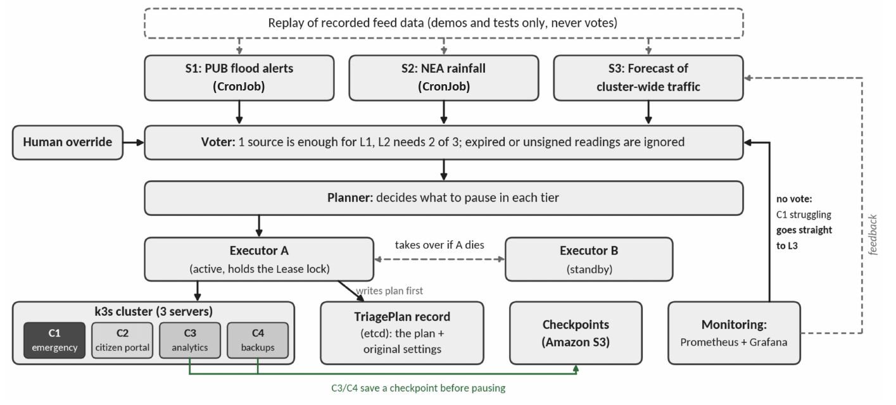

# Lifeboat: Crisis-Aware Capacity Triage on Kubernetes
CSC3104 Cloud and Distributed Computing, Group 21. Submitted tag: **`v1.0-submission`**.

When a flash flood hits, emergency websites get a traffic surge while sharing a cluster with
analytics and backups, and Kubernetes only reacts once they are already overloaded. Lifeboat is a
small Kubernetes controller that turns early warnings (PUB flood alerts, NEA rainfall and a
forecast of the cluster's own traffic) into a severity level through a 2-of-3 vote, then makes
room for the emergency service *before* the surge by pausing, not killing, less important work.
Two replicas share the plan through etcd, so a standby finishes the triage if the active one crashes.

On a 3-server k3s cluster on AWS (20x surge, 60 s warning) Lifeboat had 7 emergency pods ready
before the surge, reached full capacity 77 s into it (HPA baseline: 163 s), answered 2.5 times
as many emergency requests within 0.5 s, and lost no paused work.



## For the marker
| What | Where |
|---|---|
| Code as a container image | `GROUP21_lifeboat_image.tar.gz` (submitted file), built by [Dockerfile.submission](Dockerfile.submission) |
| Step-by-step testing instructions | **[docs/submission/GROUP21_INSTRUCTIONS.pdf](docs/submission/GROUP21_INSTRUCTIONS.pdf)** (source: [docs/TESTING.md](docs/TESTING.md)) |
| Report | `GROUP21.pdf` (submitted separately) |
| Measured results (E1-E5) and figures | [results/](results/), files explained in [Results files](#results-files) |
| Cluster guide (laptop k3d and AWS), troubleshooting | [docs/CLUSTER.md](docs/CLUSTER.md) |

Fastest check (Python 3.12, no cluster, about 2 minutes):
```bash
git clone https://github.com/aarrcane/lifeboat && cd lifeboat && git checkout v1.0-submission
python3 -m venv .venv && . .venv/bin/activate && pip install -r requirements-dev.txt
make test                                                # expected: 130 passed
```
The whole system on a laptop cluster (`make up`, `make itest`, `make demo`) is in the quick start
below and, with what you should see at each step, in the instructions PDF.

## Team
| Role | Member |
|---|---|
| Planner, checkpoints, executor, HA and crash tests | Cheung Kai Chun Ronald |
| Signals, voter and feeds | Lucas Leow |
| Cluster, deploy, AWS and CI | Hanzalah Bin Mohamad Hisam |
| Web load and baselines | Faris Zharfan |
| Observability, forecast, report and video | Muhammad 'Afif Bin Muhd Lotfi Jarhom |

## Layout
| Path | What | Proposal ref |
|---|---|---|
| `lifeboat/voter.py` | 2-of-3 vote, expiry/signature check, calm period | Alg. 1, Table 3 |
| `lifeboat/planner.py` | greedy "cheapest work to lose first" plan | Alg. 2 |
| `lifeboat/executor.py` | idempotent steps, plan-first, takeover fencing, slow revert | Alg. 3, Fig. 2 |
| `lifeboat/lease.py`, `k8s_plan_store.py` | Lease leader election; TriagePlan CRD with CAS writes | Table 1 #2, #4 |
| `lifeboat/override_store.py` | human override shared by both replicas (ConfigMap) | Sec. 4 |
| `lifeboat/k8s_actions.py`, `checkpoint.py` | target-state actions; checkpoint-before-pause contract (S3) | Table 1 #3 |
| `lifeboat/forecast.py`, `monitor.py` | Holt forecast (S3), Prometheus + C1-struggling (L3) | Sec. 4 |
| `lifeboat/forecast_eval.py`, `scripts/demo_p6.py` | forecast benchmark + alpha/beta/horizon sweep | E4 (S3) |
| `scripts/make_dashboard.py`, `deploy/monitoring/grafana-dashboard.yaml` | Grafana dashboard (18 panels in five sections) | E1-E5 |
| `scripts/p6_live_check.py` | real Prometheus + webapp + Lifeboat loop, no cluster | E1-E5 |
| `deploy/monitoring/alert-rules.yaml` | 8 Prometheus alerts, drawn on the dashboard | video |
| `scripts/plot_results.py`, `export_e4.py`, `e5_crash_test.py` | results CSVs -> figures; E4 export; E5 kill test on a cluster | E1-E5 |
| `docs/report/architecture.png`, `docs/submission/` | Figure 1; testing instructions (PDF, source `docs/TESTING.md`) | report |
| `lifeboat/controller.py`, `operator.py` | sense-decide-act loop, Kopf entrypoint | Fig. 1 |
| `feeds/`, `deploy/feeds/` | PUB (S1) / NEA (S2) feed functions, run as CronJobs (`make feeds`; OpenFaaS packaging in `feeds/stack.yml`), replayer | Sec. 4.1, 5 |
| `workloads/` | C1/C2 web app, C3/C4 checkpointing worker | Sec. 6 |
| `deploy/` | CRD, RBAC, 2-replica Lifeboat, demo tiers, PodMonitors | |
| `loadtest/` | Locust 20x surge | E1/E2 |
| `tests/` | unit tests incl. crash-takeover scenario (Fig. 2) | E4/E5 |

## Quick start (laptop: Docker + k3d + kubectl + helm)
Full guide, AWS run and troubleshooting: **[docs/CLUSTER.md](docs/CLUSTER.md)**. `make help` lists every target.
```bash
pip install -r requirements-dev.txt && make test        # logic tests, no cluster needed
make up                                                  # = make cluster import deploy monitoring workloads wait:
                                                         #   3-server k3d cluster, images, secrets, MinIO,
                                                         #   controller x2, Prometheus, demo tiers
make itest                                               # real-cluster check: Lease, TriagePlan, takeover, revert
make demo                                                # 20x surge + flood warning 60 s ahead, speed 1 (~8 min)
make experiment RUNS=1                                   # measure E1/E2/E3 for B0, B1, B2, lifeboat
kubectl -n lifeboat get triageplans -w                   # watch the plan
make reset                                               # clean L0 before the next run
```
In the cluster, checkpoints go to S3: MinIO on laptops (`deploy/05-checkpoint-store.yaml`), a real bucket on AWS (`S3_MODE=aws` in `.env`). Secrets come from your local `.env` (`make secrets`), never from git. The `file` backend is only for unit tests and running the worker on your laptop, since pods don't share `/tmp`.

## Baselines
All four setups run on the same workloads, load and replayed warnings, with the same cool-down
(HPA scale-down window 60 s, `LIFEBOAT_CALM_MINUTES=1`). `scripts/run_experiment.py` sets them up.
- **B0** HPA + pod priority: `deploy/01-priorityclasses.yaml`, `04-demo-workloads.yaml` and the C1 autoscaler `deploy/baselines/hpa-c1.yaml` (CPU 70 %, 2-20 pods); Lifeboat scaled to 0, placeholders 0.
- **B1** HPA + pod priority + spare room: B0 + 2 `placeholder` pods (already in `04`).
- **B2** Lifeboat reacting only to measured distress: `LIFEBOAT_EARLY_WARNING=false` (ignores S1-S3, only the measured L3 path fires), no HPA.
- **lifeboat** full Lifeboat, no HPA. The HPA must never run next to Lifeboat: two controllers writing C1's replicas fight.

## Human override
An operator can lock the level (for a drill, or to stop triage) through either Lifeboat pod. It is
stored in the ConfigMap `lifeboat-override`, so every replica applies it and it survives a takeover.
Every override is logged and counted (`lifeboat_overrides_total`).
```bash
TOKEN=$(kubectl -n lifeboat get secret lifeboat-secrets -o jsonpath='{.data.LIFEBOAT_HMAC_SECRET}' | base64 -d)
kubectl -n lifeboat port-forward deploy/lifeboat 8081:8081 &
curl -s -X POST localhost:8081/override -H "X-Lifeboat-Token: $TOKEN" -d '{"level": 2, "who": "alice"}'     # lock at L2
curl -s -X POST localhost:8081/override -H "X-Lifeboat-Token: $TOKEN" -d '{"level": null, "who": "alice"}'  # back to the vote
```
`level` must be `null` or 0-3 (anything else: 400). `make reset` removes the override.

## Results files
Every experiment ends as one CSV in `results/` (E1-E3 and E5 measured on AWS, 3 x t3.large, 3 runs
per setup; E4 is an offline replay through the real voter). `python scripts/plot_results.py`
turns them into `results/figures/`; cluster evidence is in `results/aws_evidence/`.

| Exp | CSV | Made by | Columns |
| --- | --- | --- | --- |
| E1/E2 | `e1_e2_summary.csv` | `scripts/run_experiment.py` | `setup` (B0, B1, B2, lifeboat), `run`; `e1_surge_to_capacity_s` (t = 150 s until C1 has 10 ready pods; negative = ready before the surge, empty = never); `alert_to_ready_s` (first level change to all planned C1 pods ready); `c1_ready_at_surge`; `c1_served_pct`, `p50_ms`, `p95_ms` (Locust, surge window, served = 200 within 0.5 s); `c2_served_pct` |
| E1 | `runs/<setup>-<run>/timeline.csv` | same | one row per second: `t,c1_ready,c1_spec,level,plan_steps,c3_suspend,c3_active,c4_suspend,c4_active,placeholder_ready`; `locust.log` and `e3.log` beside it |
| E3 | `e3_work_saved.csv` | same, from worker lifecycle events in the checkpoint store | `setup,run,workload`; `progress_lost_s` (work redone after resuming); `restore_s` (crisis end until running again at original settings) |
| E4 | `e4_alerts.csv` | `scripts/export_e4.py` | `scenario,true_crisis,voter,peak_level,false_l2_alarms,false_l2_s,missed,flips` (`naive` = any one source, `lifeboat` = 2 of 3) |
| E5 | `e5_crash.csv` | `scripts/e5_crash_test.py` (during a replay at L2) | `test,run,takeover_s`; plan steps total / left half done / mismatched (target 0); `takeover_increment` (fencing, at least 1); level and steps before and after; `plan_kept`; Lifeboat CPU and memory |

`results/model/e1_e2_model.csv` (`scripts/run_p5_baseline.py`) is the pre-AWS model prediction,
not a measurement.

## Known limits
C1 is sized from the traffic it *serves*, so a sudden surge is followed step by step; the planner
checks cluster-wide free CPU, not per-node fit; Lease expiry assumes NTP-synchronised clocks; the
experiments shorten the calm period to 1 minute; one signing key for all feeds and the override.
Everyone deploying to the same cluster needs the same `.env` (shared privately, see `docs/CLUSTER.md`).
