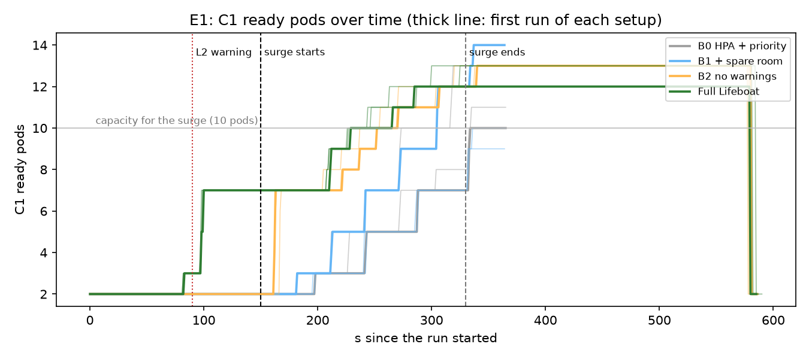

# Lifeboat: Making Room Before the Flood

*Crisis-aware capacity triage on Kubernetes*

CSC3104 Cloud and Distributed Computing, Group 21

## Abstract

When a flash flood hits Singapore, thousands of people open the same emergency websites at
once. Those sites usually share a cluster with less urgent work like analytics and backups, and
Kubernetes only reacts once the emergency service is already overloaded. Yet the warning signs
come earlier: PUB issues flood alerts and NEA's rain gauges spike *before* the traffic arrives.
Lifeboat is a small Kubernetes controller that turns those warnings, plus a forecast of the
cluster's own traffic, into a severity level through a 2-of-3 vote. It then makes room for the
emergency service in advance by pausing (not killing) less important work, and it finishes the
job even if it crashes halfway. On a three-server cluster on AWS, with a 20× traffic surge and a
60-second warning, Lifeboat had 7 emergency pods ready before the surge and reached full
capacity 77 s into it, against 163 s for the standard Kubernetes autoscaler. It answered 2.5 times
as many emergency requests within 0.5 s, the slowest 5 % took 2.9 s instead of 5 s, and no
paused work was lost.

## 1. Introduction

Most organisations run everything on one shared cluster: the website citizens use in an
emergency, but also nightly analytics, backups and model training. That is cheap on a normal
day. The trouble is that the emergency website gets its biggest spike on the worst possible day,
when the cluster is still busy with work that could easily wait.

Kubernetes has tools for this. Pod priority [1] lets important pods push out less important
ones, Jobs can be suspended [2], placeholder pods can hold spare room [3], and autoscalers add
pods under load [4][5]. But **all of them react after the pressure has arrived.** By the time an
autoscaler notices that CPU is maxed out, people are already waiting.

Our idea is simple: **use the warning time.** If we know a flood is coming, we can make room
before the traffic arrives, as long as we do it safely. That gives Lifeboat three goals:

1. **Don't trust a single warning.** Sensors can be wrong, late, offline or forged, so three
   sources vote, and one bad reading can only trigger cheap, reversible steps.
2. **Pause work, don't destroy it.** Jobs save their progress first, and Lifeboat pauses the ones
   that lose the least.
3. **Don't let Lifeboat become the weak point.** Two copies run; if the active one crashes
   halfway, the standby finishes the written-down plan.

We use four service tiers: **C1** the emergency website (must stay fast), **C2** the citizen
portal (can switch off extras), **C3** analytics jobs and **C4** backups (both can pause).

## 2. System design


Lifeboat runs a loop every 5 seconds: collect the latest warnings, **vote** on a level, **plan**
what the cluster should look like, and **execute** the plan, writing each step down first.

### 2.1 Three warning sources, one vote

| Source | Watches | Level it can vote |
| --- | --- | --- |
| S1 PUB | official flood alerts from data.gov.sg [6] | any active alert → L2 |
| S2 NEA | heaviest 5-minute rainfall on the island [7] | 2.5 mm (≈30 mm/h) → L1; 7.5 mm (≈90 mm/h, above NEA's 70 mm/h heavy-rain warning) → L2 |
| S3 Forecast | traffic on our own cluster | 2× normal → L1; 4× normal → L2 |

| Level | When | What happens |
| --- | --- | --- |
| L0 Normal | no warnings | nothing |
| L1 Watch | any **one** source warns | pause backups, add one emergency pod |
| L2 Emergency | **two** sources agree within 10 min | remove spare pods, grow C1 in advance, pause batch work |
| L3 Critical | C1 is *measurably* struggling | pause everything pausable, add pods, trim C2 |

The vote is the key design choice. A wrong reading from any one source, including our own
forecast, can only reach L1, which costs one spare pod. Real disruption needs two independent
kinds of evidence. Going up is immediate, but going down takes one "calm period" (5 minutes) per
level, so the level can't flip back and forth. Every reading is signed (HMAC-SHA256) and expires,
so forged or stale readings are thrown away before the vote. L3 skips the vote because it is
based on measurement, not prediction: C1's slowest 5 % of requests take over 0.5 s, or new C1
pods can't find a machine for 20 s.

### 2.2 Forecasting our own traffic

For S3 we use **Holt's linear trend method** [8]. It keeps a smoothed *level* (how busy we are)
and a *trend* (how fast that is changing), and projects them 3 minutes ahead:

```
level_t = α·traffic_t + (1 − α)(level_{t−1} + trend_{t−1})
trend_t = β(level_t − level_{t−1}) + (1 − β)·trend_{t−1}
forecast(3 min) = level_t + 12 × trend_t
```

We chose Holt over ARIMA or a neural network because it needs no training data (we have no real
flood-day traffic), it is cheap enough to run every 15 seconds, and every number in it can be
explained. Its weakness is that it knows nothing about daily patterns. If Prometheus goes down,
the forecast simply skips the sample, so a monitoring outage can never cause a false emergency.

### 2.3 Deciding what to pause

At L2 the planner grows C1 *before* traffic arrives, removes placeholder pods, and if C1 still
doesn't fit, pauses the batch job that frees the most CPU for the least lost work.

**A worked example.** A request costs 20 ms of CPU and a C1 pod gets a quarter of a CPU, so one
pod handles about 12.5 requests/s. Normal C1 traffic in our test is 6 requests/s; the surge peaks
at 120. At L2, Lifeboat prepares for 10× normal: 60 requests/s × 20 millicores + a 500 millicore
margin = 1700 millicores, or **7 pods**, before any extra traffic exists. When the surge arrives
it sizes for what it actually sees: 120 requests/s means **12 pods**. It doesn't fully trust the
forecast here, because Holt overshoots sudden jumps (it predicted 339 requests/s for a true 120).

### 2.4 Surviving its own crash

Two copies of Lifeboat run, but only the holder of a Kubernetes **Lease** [9] may act. If the
holder stops renewing it, the lease expires after 15 s and the standby takes over. Before acting,
the active copy writes the plan and every workload's original settings into a **TriagePlan**
object. Each step describes a target state ("this Job is suspended", "C1 has 7 pods"), so doing
it twice does no harm, and a new executor can simply carry on. Each takeover stamps a higher
**takeover number** on the plan, and plan writes with an older number are rejected, so a frozen
old copy cannot overwrite the plan. Before each change to a workload the executor also checks it
still holds the Lease, and every step is safe to repeat.

Before pausing a job, Lifeboat asks it to save a checkpoint and waits up to 6 seconds. The job
writes its data first and a small "latest" pointer last, so a half-written checkpoint is never
used, and on resume it continues from there.

## 3. Implementation

| Part | What we used |
| --- | --- |
| Cluster | k3s on 3 servers sharing an embedded etcd database [10]; k3d on laptops |
| Cloud | AWS Academy Learner Lab: 3 × t3.large (2 vCPU, 8 GiB), about US$0.26/hour |
| Controller | Python with Kopf, 2 copies, leader election with a Lease |
| Warning feeds | Kubernetes CronJobs calling the live data.gov.sg APIs; a reply they cannot read sends nothing |
| Checkpoints | Amazon S3 (MinIO on laptops) |
| Monitoring | Prometheus and Grafana, an 11-panel dashboard and 8 alerts |

**Fault tolerance at every layer.** All three AWS machines are k3s *servers* that share the
cluster database, so losing any one of them still leaves a working majority, and Lifeboat's
lease and plan survive with it. Lifeboat itself runs as two copies (Section 2.4). The warning
feeds send every reading to *both* copies, so the standby is always up to date.

**Concurrency.** The only shared state is the TriagePlan, and every write to it is a
compare-and-swap that also checks the takeover number. Two executors can never both change the
plan, and an alert raises a warning on the dashboard if two copies ever both think they are
active.

**One command per layer.** One script builds the whole AWS side (machines, firewall, a fixed IP
address for server-1, and the S3 bucket), and `make up` installs everything on top and waits
until it is running. On a laptop, the same command first creates a local three-server cluster.

**Security.** The firewall only admits our own IP address. The Learner Lab doesn't allow
access keys, so nothing in the cluster holds one: the machines carry a lab role that lets the
checkpoint code reach S3. The signing key never enters git, lives in a Kubernetes Secret, and
every server encrypts Secrets on disk. Lifeboat may only change objects in its own namespace and
the workload namespace; cluster-wide it can only read nodes and pods. Every push to GitHub runs unit tests, manifest checks, a
build of all three images, and a full integration test (lease, plan, takeover, undo) against a
real Kubernetes API server.

**What didn't go to plan.** Our proposal planned to run the feeds on OpenFaaS, but its free
edition no longer supports the features we needed without an image registry and extra pods. On
2-CPU machines that wasn't worth it for a job that runs every few minutes, so we use plain
CronJobs, and the code stays OpenFaaS-ready. Testing also caught real bugs: missing monitoring
data was being treated as "zero traffic"; the forecast cast a phantom vote minutes after a surge
ended; and the very first forged reading couldn't trigger an alert. A final review found more:
a monitoring outage kept the last forecast vote alive, a human override reached only the pod
that received it, and one future-dated reading could mute a source. All are fixed and covered by
tests.

## 4. Evaluation

### 4.1 Method

Every run follows the same script on the AWS cluster. Normal traffic flows first. At **t = 75 s**
NEA reports heavy rain, and at **t = 90 s** PUB and NEA both report a flood. At **t = 150 s** the
surge hits: users jump from 10 to 200, a **20× increase**, for 3 minutes, with 60 % on the
emergency site (C1) and 40 % on the citizen portal (C2). Batch jobs run throughout. So Lifeboat
gets a **60-second head start**, and a request only counts as served if it succeeds within
**0.5 s**. We replay scripted warnings because a real flood can't be scheduled and every setup
must see identical inputs. To fit a run into 10 minutes, the calm period is shortened to
1 minute (5 by default), the forecast learns "normal" from 4 samples instead of 8, and the
autoscaler's scale-down window is 60 s.

| Setup | What it is |
| --- | --- |
| **B0** | Kubernetes out of the box: an autoscaler (HPA, 2–20 pods at 70 % CPU) plus pod priority |
| **B1** | B0 plus spare room held by placeholder pods |
| **B2** | Lifeboat with warnings off, so it only reacts once C1 struggles |
| **Lifeboat** | the full system |

Each setup ran **3 times** on AWS, taking turns. Our first full run showed Lifeboat preparing
only 4 pods instead of 7: the test script restarted it while the cluster was idle, so it learned
that "normal" was almost zero. We fixed the script to let normal traffic run for 3.5 minutes
first, and re-ran all 12 runs.

### 4.2 Speed and service quality (E1, E2)

| Setup | C1 pods ready at surge | Time to full capacity (range) | C1 requests served in 0.5 s | Slowest 5 % (p95) | C2 served in time |
| --- | --- | --- | --- | --- | --- |
| B0 autoscaler | 2 | 163 s (123–184) | 3,117 (33 %) | 5.0 s | 0.3 % |
| B1 + spare room | 2 | 171 s (155–186) *(1 run never got there)* | 2,728 (29 %) | 5.0 s | 0.3 % |
| B2 no warnings | 2 | 97 s (87–102) | 7,074 (47 %) | 3.9 s | 41 % |
| **Lifeboat** | **7** | **77 s (76–79)** | **7,698 (47 %)** | **2.9 s** | **41 %** |

*Means of 3 runs. Requests served: C1 requests answered within 0.5 s during the 3-minute surge
(21,600 were offered: 120 users, one request per second each); in brackets, the share of the
requests actually sent.*



**The warning buys speed.** Lifeboat entered the surge with 7 pods instead of 2, and reached
full capacity **86 s sooner than the standard autoscaler** and 20 s sooner than the same
controller without warnings.

**It serves far more of the emergency traffic.** Each simulated user waits for an answer before
sending the next request, so an overloaded setup also *receives* fewer requests. Counted in
requests, Lifeboat answered 7,698 emergency requests in time, 2.5 times as many as the
autoscaler (3,117). The share of sent requests (47 % against 33 %) hides most of that gap.

**But a 20× surge still hurts.** No setup kept every request under 0.5 s: the first part of the
surge is rough while the last pods start. Lifeboat served about 9 % more requests in time than
B2, and its slowest 5 % took 2.9 s against 3.9 s for B2 and the 5 s limit for both autoscaler
setups. The citizen portal C2 gains from the L3 step that switches off its extra features
(each request then costs a fifth of the CPU): with B0 and B1, which have no such step and no
autoscaler for C2, it almost completely failed (0.3 %), while Lifeboat kept 41 % in time.

**Why the baselines are slow, and why Lifeboat still needs 77 s.** C1 pods have a CPU limit equal
to their request, so CPU use cannot pass 100 % against the autoscaler's 70 % target, and the HPA
grows C1 by only about 1.5× per step (2, 3, 5, 7, 10 pods, 30–45 s apart). In one B1 run the
spare room was never used: the autoscaler, not free room, was the bottleneck. A request-rate
autoscaler such as KEDA [4] would be a stronger baseline. Lifeboat's own limit is its sizing rule:
it sizes C1 from the traffic C1 *serves*, at most 1.25× above it, and served traffic cannot exceed
current capacity. So it held 7 pods for the first 55 s of the surge, then grew step by step.


### 4.3 Lost work, false alarms and crashes (E3, E4, E5)

**No work lost (E3).** In every Lifeboat and B2 run, the analytics and backup jobs resumed
exactly where they stopped: **zero progress lost** across all runs. They were back about
4 minutes after the surge ended, 7 to 8.5 minutes after they were paused. That is the price of
triage: with B0 and B1 batch work was hardly interrupted (one 35 s restart in twelve job runs).
The workers also save on SIGTERM, so E3 shows that nothing is lost, not how much the checkpoint
request adds on its own.

**No false alarms (E4).** We ran four scripted scenarios through the real voter:

| Scenario | Real flood? | False emergencies, naive "any 1 source" | False emergencies, Lifeboat |
| --- | --- | --- | --- |
| Flash flood | yes | – | – (caught at L2) |
| Noisy sensor | no | 3 | **0** |
| Conflicting feeds | no | 2 | **0** |
| No crisis | no | 1 | **0** |

We also tuned the forecast over 27 settings on simulated traffic. Our choice warned 81 s early
on a gradual surge with zero false emergencies on normal days, where our starting setting raised
11. On a *sudden* jump, however, there is no trend to spot and the forecast gives no early warning.
That is exactly why PUB and NEA matter.

**Surviving a crash (E5).** During a demo run on AWS we killed the active copy of Lifeboat
without warning, three times, each time during an active triage:

| Kill | Standby took over after | Takeover number | Plan kept? | Done steps not in target state | Steps still pending after 30 s |
| --- | --- | --- | --- | --- | --- |
| 1 | 17.6 s | +1 | yes | 0 | 2 |
| 2 | 12.8 s | +1 | yes | 0 | 0 |
| 3 | 21.6 s | +1 | yes | 0 | 0 |

The standby took over in about 17 s, which is the 15 s lease plus one or two 5 s ticks, and C1
kept its pods during the handover. No step marked done had drifted. In kill 1 the level rose
from L2 to L3 while the standby was taking over, which added two new steps; they were still
being carried out when the 30 s measurement ended. Lifeboat itself is light: 20–26 millicores of CPU and about
115 MiB of memory.

## 5. Related work

| System | What makes it act | What it does | What Lifeboat adds |
| --- | --- | --- | --- |
| Kubernetes pod priority [1] and HPA | an important pod can't be scheduled; CPU is high | evicts less important pods; adds pods | acts *before* the pressure, picks what to pause by work lost, restores in order |
| Kueue [11] | a resource quota runs out | suspends and requeues batch jobs | decides *when* and *what* from outside warnings |
| Phoenix [12] | hardware capacity is lost | switches off less important stateless containers | acts on predicted surges, pauses stateful work safely, survives its own crash |
| GreenScale [13] | an energy or carbon forecast | packs pods and powers machines off | different goal; Lifeboat is fully undoable and reacts in seconds |
| Borg [14], Defcon [15], Netflix [16] | overload | priority bands, feature switches, load shedding | adds early warnings and crash-safe, tiered triage |

These systems either react once overload has happened, or plan around resources over hours.
None uses *outside* warnings to act ahead of a surge. Our B0 baseline is exactly what Kubernetes
offers today; it does get there in every run, just 86 s later.

## 6. Conclusions and future work

Lifeboat shows that a public flood warning, arriving just a minute before the traffic, makes a
real difference. On AWS it had 7 emergency pods ready when a 20× surge hit, reached full
capacity in half the time a standard autoscaler needed, and answered 2.5 times as many
emergency requests in time. Worst-case response times were lower,
no paused work was lost, and it carried on smoothly when we killed its active copy. It does not
make a 20× surge painless on a small cluster: the first minute is still rough. What it does is
shorten the bad part and put the emergency service first in line.

Our main lesson is that a warning only helps if everything that acts on it already knows what
"normal" looks like: a freshly restarted Lifeboat prepared 4 pods instead of 7.

**Beyond floods: any disaster, anywhere.** We used floods because they are
Singapore's real risk, but nothing in Lifeboat is flood-specific. The voter simply counts signed readings
from *any* named source, so a new hazard only needs a small feed that turns a public warning
into a level, registered in one line of `feeds/handler.py`. As a proof of concept we wrote one
for earthquakes (`feeds/usgs_quake.py`, `FEED_SOURCE=S4`; unit tested but not deployed or
evaluated). Other regions could plug in their own:

| Hazard | Public feed | L1 Watch | L2 Emergency |
| --- | --- | --- | --- |
| Earthquake | USGS live quake feed | magnitude 5+ within 300 km | magnitude 6.5+, or USGS tsunami flag |
| Tsunami | national tsunami warning centres | tsunami watch | tsunami warning |
| Hurricane / typhoon | US NHC, Japan JMA advisories | storm within 72 h | landfall within 24 h |

The safety rule stays the same everywhere: one feed alone can only reach L1, so a quake alert
still needs a second kind of evidence, such as the traffic forecast, before anything is paused.

**Limits and future work.** We tested one small cluster, synthetic workloads, a fixed 60-second
warning and 3 runs per setup, and no real flood happened during the project, so warnings were
replayed. Next we would: keep the learned baseline across restarts; size C1 from offered rather
than served traffic once it is measurably struggling; check per-node fit instead of cluster-wide
free CPU; give each source and the human override its own key; run two copies of Prometheus;
and use Holt-Winters to learn daily traffic patterns. Lease expiry assumes the servers' clocks
agree (NTP).

## Team contributions

| Role | Member | Main work |
| --- | --- | --- |
| P1/P3 Planner, checkpoints, executor, HA & chaos | TODO (R1/R3 merged role) | planner and greedy ordering, checkpoint-before-pause, discovery, Lease/takeover, safe execution and crash tests (E3/E5) |
| P2 Signals, voter & feeds | Lucas Leow (2502908) | signing, ingest, 2-of-3 voter, PUB/NEA live feeds, E4 scenarios |
| P4 Cluster, deploy & AWS | TODO | 3-server k3s, one-command deploy, AWS EC2 and S3, CI |
| P5 Web load & baselines | TODO | web app, Locust surge, B0–B2, experiment runner (E1/E2) |
| P6 Observability & forecast | Muhammad 'Afif Bin Muhd Lotfi Jarhom (2500708) | forecast tuning, monitoring and alerts, dashboard, results pipeline, report, video |

## References

[1] Kubernetes: Pod Priority and Preemption. https://kubernetes.io/docs/concepts/scheduling-eviction/pod-priority-preemption/

[2] Kubernetes Jobs: Suspending a Job. https://kubernetes.io/docs/concepts/workloads/controllers/job/#suspending-a-job

[3] Kubernetes: Overprovision Node Capacity For A Cluster. https://kubernetes.io/docs/tasks/administer-cluster/node-overprovisioning/

[4] KEDA Metrics API scaler. https://keda.sh/docs/2.20/scalers/metrics-api/

[5] Karpenter. https://karpenter.sh/

[6] PUB Flood Alerts across Singapore (data.gov.sg). https://data.gov.sg/datasets/d_f1404e08587ce555b9ea3f565e2eb9a3/view

[7] NEA Rainfall across Singapore (data.gov.sg). https://data.gov.sg/datasets/d_6580738cdd7db79374ed3152159fbd69/view

[8] Hyndman & Athanasopoulos, Forecasting: Principles and Practice, 3rd ed., §8.2 (Holt linear trend). https://otexts.com/fpp3/holt.html

[9] Kubernetes: Leases. https://kubernetes.io/docs/concepts/architecture/leases/

[10] K3s datastore options. https://docs.k3s.io/datastore

[11] Kueue: preemption, suspend and requeue. https://kueue.sigs.k8s.io/docs/concepts/preemption/

[12] Agrawal & Jyothi, Cooperative Graceful Degradation in Containerized Clouds, ASPLOS '25. https://doi.org/10.1145/3669940.3707244

[13] GreenScale pitch presentation (AY25/26 Dell Cloud Native Award, CSC3104).

[14] Verma et al., Large-scale cluster management at Google with Borg, EuroSys 2015.

[15] Meza et al., Defcon: Preventing Overload with Graceful Feature Degradation, OSDI '23.

[16] Netflix TechBlog: Enhancing Netflix Reliability with Service-Level Prioritized Load Shedding.
