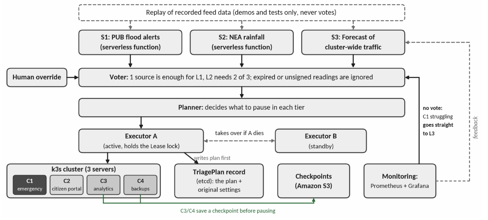
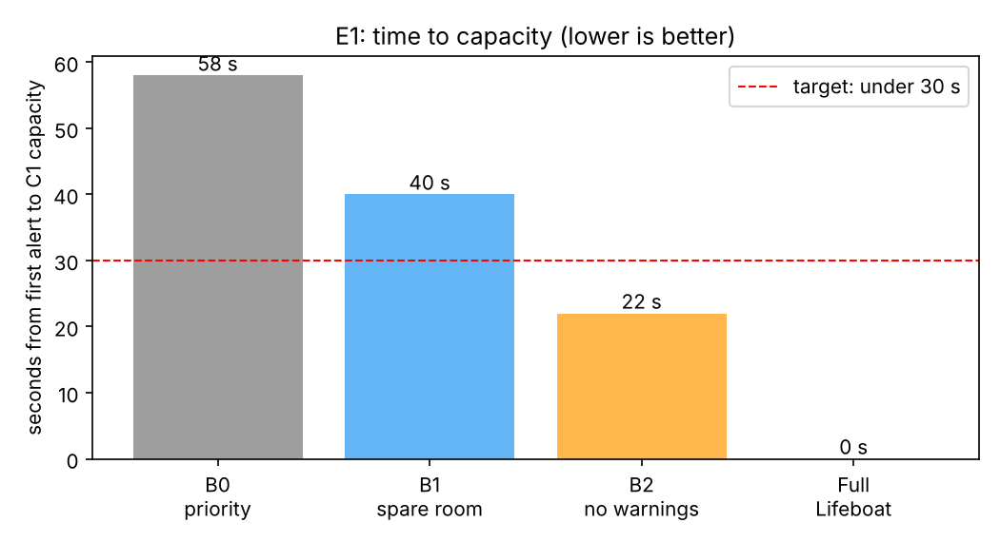
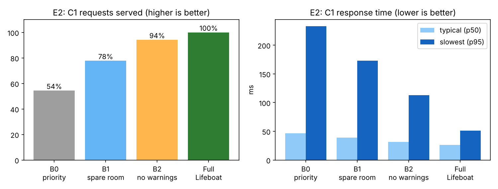
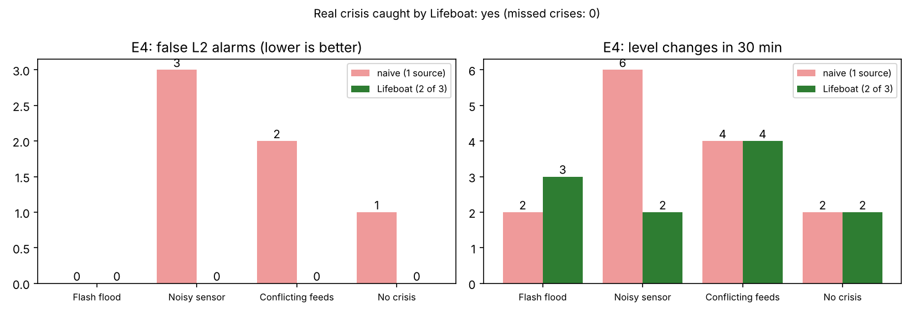
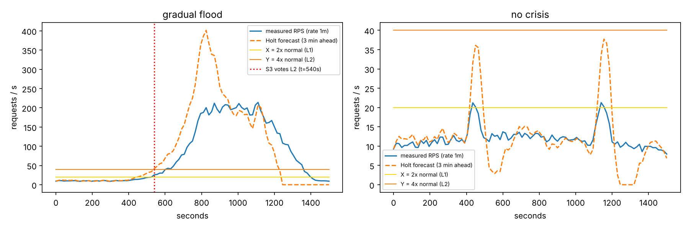
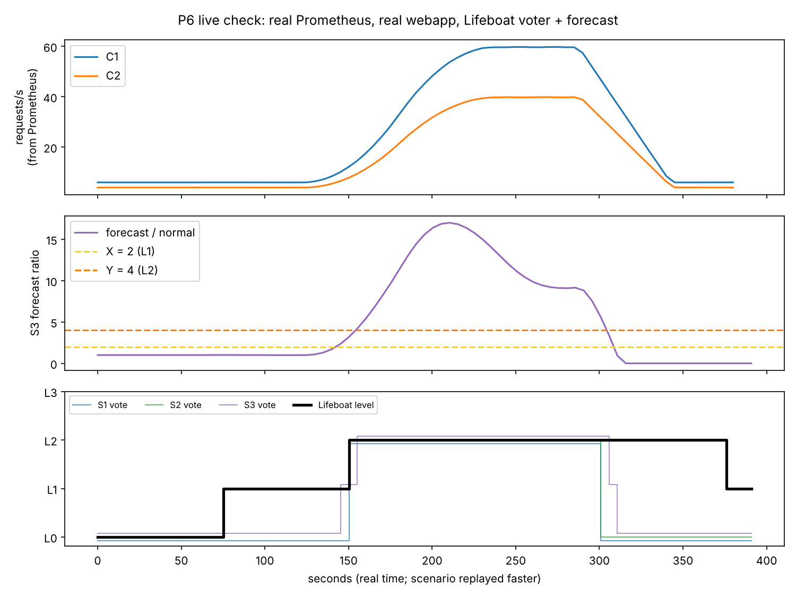

# Lifeboat: Crisis-Aware Capacity Triage on Kubernetes

CSC3104 Cloud and Distributed Computing, Final Report, Group 21

> **Draft for the team (P6 owns the merge).** Sections marked `TODO (Pn)` need that member's
> text or numbers. Every number in this draft comes from the repo: a file or command is named
> next to it. Numbers that still need a cluster run are marked **[pending]**.
> Build a PDF with `pandoc docs/report/REPORT.md -o report.pdf --resource-path=docs/report`.

## Abstract

Shared Kubernetes clusters protect critical services only after the cluster is already under
pressure: pod priority evicts lower-priority pods once an emergency pod is stuck waiting, and
autoscalers react in minutes. During a Singapore flash flood, PUB flood alerts and NEA rainfall
readings arrive *before* citizens flood the emergency websites, but that warning time is wasted.
Lifeboat is a small controller that turns three unreliable warning sources (PUB, NEA, and a
forecast of cluster traffic) into a severity level through a 2-of-3 vote, plans which batch
work to pause by how little progress would be lost, and carries the plan out with an
active/standby executor that survives its own crash mid-triage. TODO (all): one sentence with
the headline E1 result once the AWS run is done.

## 1. Introduction

Most organisations run all services on one shared cluster. This is efficient most of the time,
but critical services see their peak traffic exactly when the cluster is busiest. In a flash
flood, emergency alert and citizen help sites get very busy while the cluster is still full of
work that could wait: analytics, backups, model training.

Kubernetes already has the controls (pod priority [1], Job suspension [4], placeholder pods [5],
autoscalers [6][7]) but all of them react *after* pressure appears. Lifeboat adds the missing
decision: **use early warnings to make room before the surge, without losing the paused work,
and keep working when parts of Lifeboat itself fail.**

**Contributions.**
1. Acting early on outside warnings plus our own forecast, guarded by a 2-of-3 vote so one bad
   reading only triggers cheap, reversible steps.
2. Pausing and resuming work instead of killing it: work is checkpointed first, the planner
   pauses whatever loses the least progress, and everything returns slowly in order.
3. Crash-safe triage: a plan is written before any action, and a standby executor with a higher
   takeover number finishes a triage that its crashed predecessor left half done.

## 2. Problem and challenges

| Challenge | Why it is hard | Lifeboat's answer |
| --- | --- | --- |
| 1. Unreliable warnings | feeds can be late, wrong, offline or forged | signed, expiring readings; L2 needs 2 of 3 sources; stepping down waits for a calm period |
| 2. Crashing halfway | Kubernetes can't change many objects atomically | plan-first (TriagePlan in etcd), target-state steps that are safe to repeat |
| 3. Losing paused work | suspending a Job deletes its pods | checkpoint before pause; resume from `latest.json` |
| 4. Lifeboat as a single point of failure | the controller can die mid-crisis | two replicas, Lease leader election, takeover numbers fence the old executor |

When C1 is *already* struggling (measured, not predicted), Lifeboat skips the vote and goes
straight to L3.

## 3. Related work

| System | Trigger | What it does | What Lifeboat adds |
| --- | --- | --- | --- |
| Pod priority [1] | a higher-priority pod is stuck | evicts lower-priority pods | acts before the cluster is full; picks by work lost; restores in order |
| Kueue [9][10] | quota exhausted | suspends/requeues lower-priority batch jobs | decides *when* and *what* from warnings |
| Phoenix [14] | hardware capacity lost | switches off less important stateless containers | acts on predicted surges; stateful pause/resume; voting + standby executor |
| GreenScale [15] | energy/carbon forecast | packs pods, powers machines off | different goal; undoable; standby executor; reacts in seconds |
| Borg [11], Defcon [12], Netflix [13] | overload | priority bands, feature switches, load shedding | combine early warnings with tiered, crash-safe triage |

## 4. Design




### 4.1 Warning sources and signed readings (P2)

Each source sends `{source, level, ts, expires_at, sig}`, signed with HMAC-SHA256
(`lifeboat/signing.py`). Ingest (`lifeboat/ingest.py`) rejects malformed (`400`), badly signed
(`401`) or expired (`422`) readings before the voter sees them, and counts each rejection by
reason (`lifeboat_rejected_readings_total{reason}`).

| Source | Data | TTL | Runs as |
| --- | --- | --- | --- |
| S1 PUB flood alerts | data.gov.sg real-time API [2] | 150 s | scheduled function, CronJob (`*/2 * * * *`) |
| S2 NEA rainfall | data.gov.sg real-time API [3] | 330 s | scheduled function, CronJob (`*/5 * * * *`) |
| S3 traffic forecast | cluster-wide request rate (Section 4.3) | 60 s | inside the controller |

**Deployment as scheduled functions, and dual-replica fan-out.** Each feed is a short,
stateless function (`feeds/handler.py`): fetch the API, score it, sign one reading, send it, exit.
The proposal planned to host these on OpenFaaS. We kept the code OpenFaaS-compatible
(`feeds/stack.yml`, `python3-http` `handle()` entrypoint), but run it in the cluster as two
Kubernetes CronJobs (`deploy/feeds/feeds-cronjobs.yaml`, `make feeds`): `pub-feed` every 2 min and
`nea-feed` every 5 min, each starting one pod with `python -m feeds.handler --once`. The reason is
practical: OpenFaaS Community Edition no longer includes the `Function` CRD/operator, and it
always pulls function images from a registry, while our k3s nodes run images imported by
`make import`. Adding a registry and a gateway would cost CPU on 2-CPU nodes and add moving parts
that a 2-to-5-minute schedule does not need. A CronJob gives the same function-as-a-service
properties that matter here (no idle process, one isolated run per trigger, retries and history
kept by Kubernetes) with nothing extra to install. `concurrencyPolicy: Forbid` stops overlapping
runs, `activeDeadlineSeconds: 60` kills a hung fetch, and a failed run simply sends nothing, so
the previous reading expires by its TTL instead of being trusted forever. The HMAC secret comes
from `lifeboat-secrets`. When sending, `feeds/common.py:targets()` resolves the headless Service
`lifeboat-ingest.lifeboat.svc.cluster.local:8081` (`deploy/03-lifeboat.yaml`) to every pod IP and
`POST`s each reading to **both** Lifeboat replicas, so the standby voter stays warm if the active
leader crashes. Live feeds and replayed scenarios must not run together, because the voter keeps
the latest reading per source and a live L0 would replace a replayed L2; `make replay` and
`make reset` therefore switch the live feeds off first (`make feeds-off`), and all experiments in
Section 6 use replayed readings.

**Live endpoint checks (`python scripts/demo_p2.py --live`).** Both feeds were verified against
the live `api-open.data.gov.sg` v2 endpoints (with a custom `User-Agent: lifeboat-feed/1.0`
header, as the default `Python-urllib` header is blocked with HTTP 403 by Cloudflare). The test
fixtures in `tests/fixtures/` follow the live response shapes; because no PUB flood alert was
active during our checks, the alert fixture (`pub_flood_alert.json`) is constructed in that shape
rather than recorded:
- **S1 PUB flood alerts (`feeds/pub.py`):** Dataset `d_f1404e08587ce555b9ea3f565e2eb9a3` [2] is
  served at `/v2/real-time/api/weather/flood-alerts` (the older `/pub-flood-alerts` slug returns
  HTTP 404). A live check returns `code: 0` with 25 two-minute Common Alerting Protocol (CAP)
  observation snapshots in `data.records`, where `records[0].item.readings` lists active flood
  alert areas (`[]` during normal weather, or area objects under `msgType: "Alert"`). `count_alerts`
  inspects the latest record (ignoring `msgType: "Cancel"`) and votes **L2** when `readings` is
  non-empty, or **L0** otherwise.
- **S2 NEA rainfall (`feeds/nea.py`):** `/v2/real-time/api/rainfall` [3] returns `code: 0` with
  5-minute rain gauge totals (`TB1 Rainfall 5 Minute Total F`, in mm) across 87 active stations
  in `data.readings[0].data[].value` (and `max_rain` also supports the legacy v1
  `items[].readings[]` shape).

**NEA 5-minute rainfall cut-offs.** Because the NEA endpoint reports 5-minute bucket totals
rather than hourly rates ($\text{mm/5 min} = \text{mm/hr} \div 12$), `feeds/nea.py` maps the
island-wide maximum 5-minute reading to a severity vote using two meteorological cut-offs:
- **`NEA_L1_MM = 2.5` mm / 5 min (30 mm/hr equivalent → L1 Watch):** a moderate-to-heavy tropical
  downpour. For example, during a live check in an afternoon shower (`2026-11-11T15:40+08:00`),
  peak 5-minute rainfall was 5.2 mm (62.4 mm/hr) while PUB reported 0 flood alerts, so the
  feeds scored S2 = L1 and S1 = L0. Under Algorithm 1 one source gives **L1 Watch**, not L2, which
  is the intended outcome for heavy rain without flooding.
- **`NEA_L2_MM = 7.5` mm / 5 min (90 mm/hr equivalent → L2 Emergency evidence):** exceeds NEA's
  Heavy Rain Warning threshold of 70 mm/hr (~5.8 mm/5 min) associated with flash flood risk,
  requiring intense storm rainfall (such as the 11.4 mm / 5 min Bukit Timah reading in
  `tests/fixtures/nea_heavy_storm.json`) before S2 votes for L2.

### 4.2 Voter: severity levels (P2)

`lifeboat/voter.py` implements Algorithm 1: one valid source raises **L1 Watch**; two sources
agreeing within a 600 s window raise **L2 Emergency**; measured C1 distress raises **L3
Critical** with no vote; a human override (`POST /override` with `X-Lifeboat-Token:
<LIFEBOAT_HMAC_SECRET>`, audit-logged with the operator identity `who` in `lifeboat/ingest.py`)
locks the level or clears the lock when `level` is `null`. Only the latest valid reading per
source is counted so a single noisy sensor cannot vote twice. Going up is immediate; going down
is one level per calm period (N = 5 min), so the level cannot flip-flop.

### 4.3 Forecast (S3) and monitoring (P6)

**Data.** The only input is live web traffic. Every web app counts requests
(`http_requests_total{tier}`) and response times (`http_request_duration_seconds{tier}`).
Prometheus scrapes them every 5 s through PodMonitors, and the controller samples
`sum(rate(http_requests_total[1m]))` every 15 s. No historical dataset or training is needed.

**Model.** A Holt linear-trend model [16] keeps a smoothed level ℓ and trend b:

```
ℓ_t = α·y_t + (1 − α)(ℓ_{t−1} + b_{t−1})
b_t = β(ℓ_t − ℓ_{t−1}) + (1 − β)·b_{t−1}
ŷ_{t+h} = ℓ_t + h·b_t,  h = 12 samples (3 min)
```

The forecaster learns a "normal" baseline during an 8-sample warm-up (2 min) and only from
samples below X afterwards, so a long surge never becomes the new normal. It votes **L1** when
ŷ ≥ X·normal (X = 2) and **L2** when ŷ ≥ Y·normal (Y = 4). It can never raise L3.

We chose Holt over ARIMA or a neural model because it needs no training data (we have no real
flood-day traffic), updates in constant time every 15 s inside the controller, and every number
it uses can be explained when justifying an alert. Its limitation is that it has no seasonality.

**Why a vote and not a trigger.** PUB/NEA are *sensor* evidence; traffic is *behavioural*
evidence. Requiring two of them for L2 means a forecast error alone can only add one spare C1
pod (L1), never pause batch work.

**C1 struggling (L3).** `lifeboat/monitor.py` reports C1 as struggling if its p95 response time
exceeds 0.5 s, or if C1 pods are *Unschedulable* (not merely Pending, so Lifeboat's own scale-up
does not trigger L3).

**Failing safe.** If Prometheus is unreachable, queries return "no data": the forecaster skips
the sample and C1-struggling stays false, so an outage never causes a false L3. PUB and NEA
keep voting.

**Dashboard and alerts.** `scripts/make_dashboard.py` generates an 11-panel Grafana dashboard
as a ConfigMap (alert level and per-source votes, forecast ratio with the X/Y lines, RPS by tier,
C1 p95 vs target, plan steps, active executor, takeover number, C1 struggling, rejected readings,
free CPU). `deploy/monitoring/alert-rules.yaml` defines seven Prometheus alerts (level changes,
L2, L3, C1 slow, no active executor, two active executors, forged readings), drawn on the
dashboard as annotations for the demo video.

### 4.4 Planner (P3)

Algorithm 2 (`lifeboat/planner.py`) turns a level into steps:

- **L1:** pause C4 backups (an overdue backup keeps running) and add one C1 pod early.
- **L2:** remove the placeholder pods and size C1 from the forecast: needed CPU = forecast C1
  RPS × 20 mCPU per request/s + 500 mCPU margin. If that still doesn't fit, pause batch work
  (overdue C4 first, then C3) in order of room freed ÷ (work since last checkpoint + restart
  time + 1), until the shortfall is covered.
- **L3:** pause everything pausable, add three C1 pods, and switch off C2's extra features
  through a ConfigMap.

TODO (P3): worked example and tuning of `cost_millis_per_rps`.

### 4.5 Executor, TriagePlan and takeover (P3)

Algorithm 3 and Figure 2 (`lifeboat/executor.py`, `lease.py`, `k8s_plan_store.py`): the active
replica holds a Kubernetes Lease [17] (15 s). Before acting it writes the plan and each
workload's original settings to a TriagePlan custom resource in etcd. Each step sets a target
state (Job `suspend: true`, Deployment replicas, ConfigMap data), so repeating it changes
nothing. A new holder stamps a higher takeover number into the plan; writes carrying an older
number are rejected (compare-and-swap), so a stale executor cannot interfere. TODO (P3): figure
and E5 discussion.

### 4.6 Checkpointing (P3)

Data first, `latest.json` last, so a checkpoint only counts once fully uploaded; the executor
asks a workload to save (`requests/<name>.json`) and waits up to 6 s before pausing. Checkpoints
go to MinIO on laptops and Amazon S3 on AWS. TODO (P3).

## 5. Implementation and cloud-native setup (P4)

| Concern | Choice |
| --- | --- |
| Cluster | k3s on 3 servers with embedded etcd [18]; k3d on laptops; AWS: 3 × t3.large (about US$0.26/h, Learner Lab) |
| Controller | Python + Kopf, 2 replicas, own Lease logic |
| Feeds | scheduled functions as Kubernetes CronJobs (`deploy/feeds/feeds-cronjobs.yaml`); same handlers packaged for OpenFaaS in `feeds/stack.yml` |
| State | TriagePlan CRD (`deploy/00-namespaces-crd.yaml`), Secrets encrypted at rest (k3s `--secrets-encryption`) |
| Checkpoints | MinIO (laptop), Amazon S3 (AWS) |
| Monitoring | kube-prometheus-stack (Prometheus + Grafana), PodMonitors, alert rules |
| CI | unit tests, yamllint, kubeconform, real k3s API integration test (`make itest`) |

TODO (P4): AWS instance types, cost, one-command deploy, secrets handling.

**Running the feeds: platforms considered.** The two feeds are tiny scheduled functions (one HTTP
call every 2 or 5 minutes, Section 4.1), and the cluster they run on is the one Lifeboat is trying
to free capacity in, so the platform must cost less than the work. We compared four options:

| Option | Free? | Fit for our cluster | Decision |
| --- | --- | --- | --- |
| OpenFaaS CE [19] (planned in the proposal) | yes, but the `Function` CRD/operator and `IfNotPresent` image pulls are Pro-only | CE always pulls function images from a registry; our nodes run images imported by `make import`, so it needs a registry plus a gateway | handlers kept OpenFaaS-ready (`feeds/stack.yml`), not deployed |
| Knative Serving + Eventing `PingSource` [20] | yes (CNCF graduated) | needs its own networking layer and several control-plane pods; resolves image tags through a registry by default | too heavy for 2-CPU nodes |
| Fission [21] | yes (Apache 2.0) | chart 1.27+ needs Kubernetes ≥ 1.32 (we pin k3s v1.31.4); about seven extra pods plus a volume; our handlers need a build step for the `lifeboat` package | not worth it this term; reviewed from its chart and repository, not installed |
| Kubernetes CronJob [22] | built in | nothing to install; runs the controller image already on every node | **chosen** |

A CronJob keeps the properties we wanted from serverless for these feeds: nothing runs between
triggers, every trigger is a fresh isolated pod, overlapping runs are refused
(`concurrencyPolicy: Forbid`), a hung run is killed after 60 s, and Kubernetes keeps the run
history. What it does not give is an HTTP gateway or scale-to-many, which a 2-to-5-minute poll does
not need. Moving the feeds to a FaaS platform later needs no code change, only a registry
(`faas-cli up -f feeds/stack.yml`).

## 6. Evaluation

### 6.1 Method

**Live versus replayed warnings.** Lifeboat has two ways to receive S1/S2 readings. *Live*:
`make feeds` polls the real data.gov.sg PUB and NEA APIs and sends signed readings, which shows the
real data path works. *Replayed*: `make replay` sends a scripted scenario through the same ingest
endpoint, with the same signing and TTLs. All experiments use replayed warnings, because a real
flood cannot be scheduled and every run must see the same inputs for the comparison with the
baselines to be fair. The scenarios in `data/*.jsonl` are hand-written to follow the shape of the
live data, not recordings of a real flood. The two are never mixed in one run: the voter keeps
only the latest reading per source, so a live L0 would cancel a replayed L2, and `make replay`
therefore stops the live feeds first.

All experiments replay the same scripted Singapore flash flood (`data/scenario_flash_flood.jsonl`)
while Locust sends a ~20× traffic surge at C1 and C2 and C3/C4 jobs run. Baselines on the same
workloads: **B0** pod priority only, **B1** B0 + spare room (placeholder pods), **B2** Lifeboat
with early warnings off (reacts only, roughly like Kueue/Phoenix). Each setup runs 3 times
**[pending: AWS EC2]**. Figures are produced by `scripts/plot_results.py` from the CSVs in
`results/` (formats in `docs/RESULTS_FORMAT.md`).

### 6.2 E1 time to capacity and E2 service quality (P5)




Current numbers come from P5's baseline model (`results/e1_e2_summary.csv`), not yet a cluster
run **[pending]**. TODO (P5): replace with 3 cluster runs per setup.

### 6.3 E3 work saved (P3)

**[pending]** `results/e3_work_saved.csv`. TODO (P3).

### 6.4 E4 alert accuracy (P2, P6)



Four recorded replays through the real voter (`python scripts/export_e4.py`):

| Scenario | Real crisis? | Naive (any 1 source) false L2 | Lifeboat (2 of 3) false L2 | Lifeboat peak |
| --- | --- | --- | --- | --- |
| Flash flood | yes | n/a | n/a (caught) | L2 |
| Noisy sensor | no | 3 | 0 | L1 |
| Conflicting feeds | no | 2 | 0 | L1 |
| No crisis | no | 1 | 0 | L1 |

Lifeboat caught the real flood and raised **no false L2** on the three non-crises, where a naive
voter raised six. Single-source warnings still reach L1, which by design only adds one spare C1
pod.

**Forecast tuning (S3).** `python scripts/demo_p6.py` replays three traffic shapes as Prometheus
measures them (1-minute rate, 15 s samples, ±10 % noise, 10 seeds) and sweeps 27 settings of
α, β and horizon:

| α / β / horizon | L2 lead on a gradual surge | False L2 votes (10 normal days) |
| --- | --- | --- |
| **0.3 / 0.3 / 3 min (chosen)** | **81 s** | **0** |
| 0.7 / 0.3 / 2 min | 72 s | 0 |
| 0.5 / 0.3 / 3 min (initial default) | 86 s | 11 |

8 of 27 settings raised false L2 votes; higher β or a longer horizon warns earlier but
over-reacts to short bursts. On P5's step surge (10 → 200 users at once) the forecast gives no
lead, because there is no trend before a step: early warning there must come from PUB/NEA.



**Live check with a real Prometheus.** `scripts/p6_live_check.py` runs Prometheus 2.53, two
copies of the web app under load, and Lifeboat's monitor, forecaster, voter, planner and
executor, replaying the flash flood 4× faster. All PromQL queries returned data; 11 of 12
dashboard queries returned series (free CPU needs kube-state-metrics in the cluster); Lifeboat
reached L2 at scenario t = 601 s, 261 s before traffic reached 90 % of its peak (t = 862 s); a
forged PUB reading was rejected with HTTP 401; with Prometheus killed the loop kept running with
no false L3. With the alert rules loaded, *LifeboatLevelChanged* fired at t = 340 s (the L1 step
at 300 s), *LifeboatForgedReadings* at 440 s (forgery sent at 400 s) and *LifeboatEmergency* at
640 s, with no false *LifeboatNoActiveExecutor*. Two defects were found and fixed this way:
missing Prometheus data was fed to the forecaster as 0 RPS (which poisoned its baseline), and the
first forged reading could never raise an alert because its counter did not exist before the
first increment.



### 6.5 E5 crash tests (P3, P6)

**[pending]** Run `scripts/e5_crash_test.py` during a replay: kill the active executor (once and
3× back to back), measure takeover time, steps left half done, steps drifted from the plan,
takeover increment, and Lifeboat's own CPU/memory. Unit and `make itest` results already cover
the Figure 2 scenario. TODO (P3).

## 7. Discussion and known gaps

- **Simulated inputs.** There is no real flood on demo day, so warnings are replayed and the
  forecast was tuned on synthetic traffic; re-tuning on recorded Locust traffic is future work.
  The live feeds were checked against the real APIs (Section 4.1), but no real PUB flood alert
  occurred during the project, so the L2 path from a real PUB alert is tested only with a
  constructed fixture. TODO (P4): run `make feeds` on the AWS cluster after the experiments and
  record the accepted live readings (feed job logs showing HTTP 202) as end-to-end evidence.
- **Voter state per replica.** The calm-period timer is not shared, so a newly promoted standby
  may step down one calm period later.
- **Prometheus dependency.** S3 and L3 detection need Prometheus; Lifeboat fails safe without
  it, but production should run Prometheus with two replicas.
- **No seasonality.** Holt-Winters could model daily traffic patterns.
- **Feeds on CronJobs, not OpenFaaS.** The feed handlers are OpenFaaS-compatible but run as
  CronJobs (Section 4.1). With a container registry, `faas-cli up -f feeds/stack.yml` would move
  them to OpenFaaS without code changes.
- **Tuning.** N, X, Y, NEA cut-offs and `cost_millis_per_rps` were set from the proposal and
  limited experiments.
- **"Isn't this just pod priority?"** B0 is exactly that; E1–E3 compare against it on the same
  workloads. TODO (all): state the answer with the final numbers.

## 8. Conclusion

TODO (all, after the AWS run): two or three sentences: what Lifeboat achieved against B0–B2,
and the most important lesson.

## Team contributions

| Role | Member | Main work |
| --- | --- | --- |
| P2 Signals, voter & feeds | Lucas Leow (2502908) | signing, ingest, 2-of-3 voter, PUB/NEA live feeds, E4 scenarios |
| P3 Planner, executor & HA | TODO | planner, checkpointing, executor, Lease/TriagePlan fencing, E3/E5 |
| P4 Cluster, deploy & AWS | TODO | k3s HA, manifests, CI, MinIO/S3, AWS EC2 |
| P5 Web load & baselines | TODO | C1/C2 web app, Locust surge, B0–B2, E1/E2 |
| P6 Observability & forecast | Muhammad 'Afif Bin Muhd Lotfi Jarhom (2500708) | forecast tuning, monitoring and alert rules, Grafana dashboard, results pipeline, report, video |

## References

[1] Kubernetes: Pod Priority and Preemption. https://kubernetes.io/docs/concepts/scheduling-eviction/pod-priority-preemption/
[2] PUB Flood Alerts across Singapore (data.gov.sg). https://data.gov.sg/datasets/d_f1404e08587ce555b9ea3f565e2eb9a3/view
[3] NEA Rainfall across Singapore (data.gov.sg). https://data.gov.sg/datasets/d_6580738cdd7db79374ed3152159fbd69/view
[4] Kubernetes Jobs: Suspending a Job. https://kubernetes.io/docs/concepts/workloads/controllers/job/#suspending-a-job
[5] Kubernetes: Overprovision Node Capacity For A Cluster. https://kubernetes.io/docs/tasks/administer-cluster/node-overprovisioning/
[6] KEDA Metrics API scaler. https://keda.sh/docs/2.20/scalers/metrics-api/
[7] Karpenter. https://karpenter.sh/
[8] Kubernetes Checkpoint/Restore Working Group (Jan 2026). https://www.kubernetes.dev/blog/2026/01/21/introducing-checkpoint-restore-wg/
[9] Kueue: preemption, suspend and requeue. https://kueue.sigs.k8s.io/docs/concepts/preemption/
[10] Kueue: Workload Priority Class. https://kueue.sigs.k8s.io/docs/concepts/workload_priority_class/
[11] Verma et al., Large-scale cluster management at Google with Borg, EuroSys 2015.
[12] Meza et al., Defcon: Preventing Overload with Graceful Feature Degradation, OSDI '23.
[13] Netflix TechBlog: Enhancing Netflix Reliability with Service-Level Prioritized Load Shedding.
[14] Agrawal & Jyothi, Cooperative Graceful Degradation in Containerized Clouds, ASPLOS '25. https://doi.org/10.1145/3669940.3707244
[15] GreenScale pitch presentation (AY25/26 Dell Cloud Native Award, CSC3104).
[16] Hyndman & Athanasopoulos, Forecasting: Principles and Practice, 3rd ed., §8.2 (Holt linear trend). https://otexts.com/fpp3/holt.html
[17] Kubernetes: Leases. https://kubernetes.io/docs/concepts/architecture/leases/
[18] K3s datastore options. https://docs.k3s.io/datastore
[19] OpenFaaS editions (Community Edition vs Pro). https://docs.openfaas.com/openfaas-pro/introduction/
[20] Knative documentation (Serving, Eventing PingSource). https://knative.dev/docs/
[21] Fission: serverless functions for Kubernetes (Helm chart `fission-all`). https://fission.io/docs/
[22] Kubernetes: CronJob. https://kubernetes.io/docs/concepts/workloads/controllers/cron-jobs/
